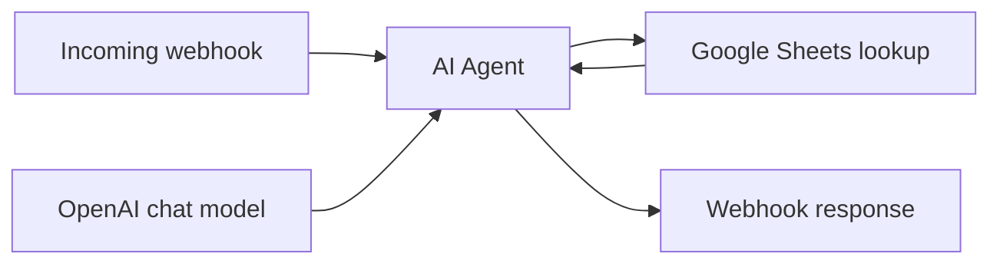
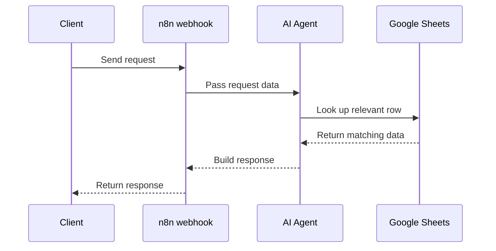

# n8n Sales Agent Workflow

An n8n workflow that receives a webhook request, processes it with an AI Agent and an OpenAI chat model, looks up information in Google Sheets, and returns a response.

## Workflow diagram

## Request flow

## Import and configure

1. In n8n, choose **Workflows** and select **Import from File**.
2. Import `My workflow 7.json`.
3. Add your own OpenAI and Google Sheets credentials in n8n.
4. Select your own Google Sheet and confirm its columns match what the workflow expects.
5. Set your webhook path, then test the workflow before activating it.

The public export uses placeholders for the webhook path and Google Sheets document reference. Connect your own resources after importing. Keep API credentials in n8n; do not add keys or passwords to this repository.
